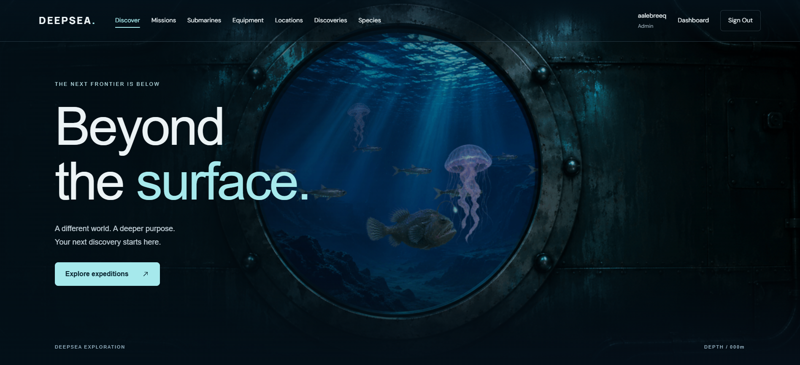
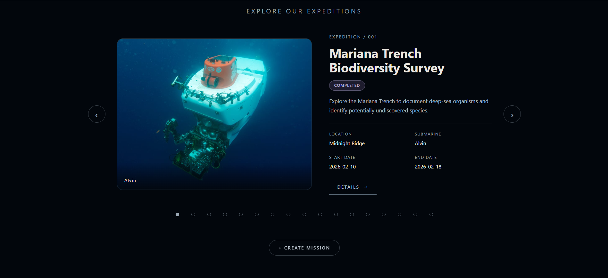
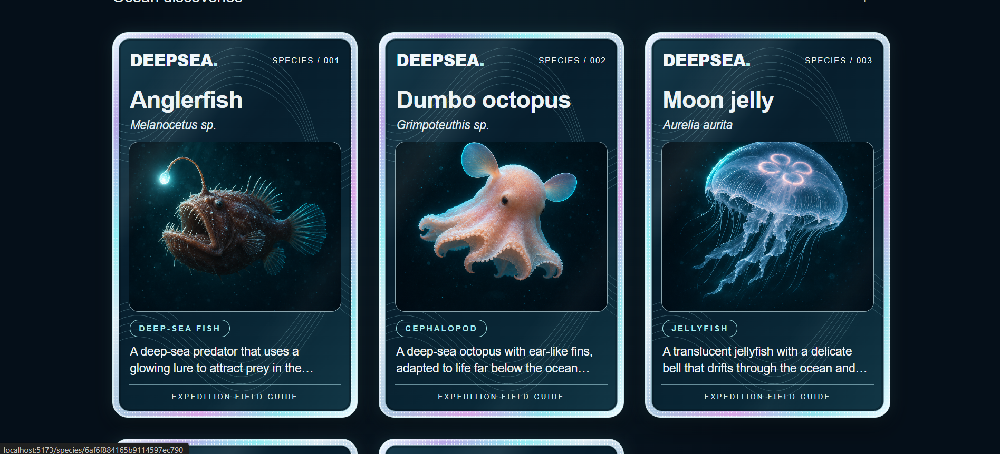
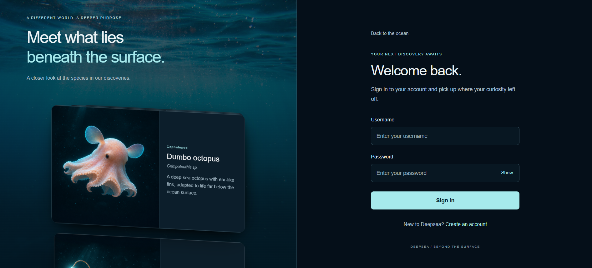
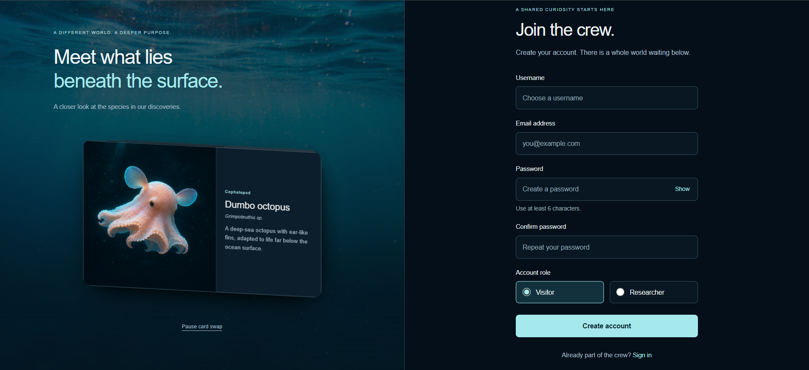
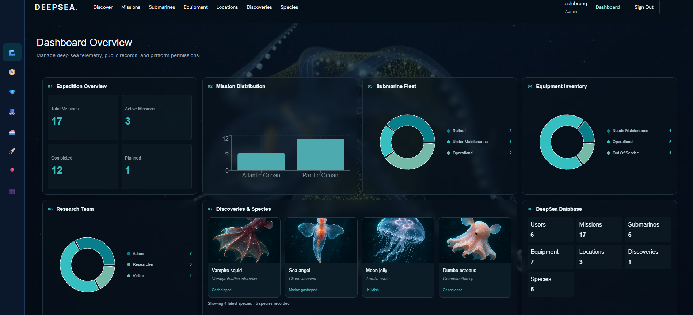

# DeepSea Expeditions Frontend

## Overview

DeepSea Expeditions is a web application for exploring ocean research missions, submarines, marine species, discoveries, equipment, and locations.

Users can browse the collections and open individual records to learn more. During registration, users choose either a Visitor or Researcher account. Visitors can view mission and submarine information, researchers can create and update these records, and administrators can also delete them.

Mission and submarine creation opens in a popup from their collection pages. Editing opens in a popup from the corresponding details page. Administrators and researchers can also join or leave a mission through its research team section.

The frontend communicates with a separate backend API through Axios. Signing in stores the access token in local storage, and the Axios request interceptor attaches it to subsequent API requests.

## Live Application

- **Frontend:** 
- **Backend API:** 
- **Frontend Repository:** [frontend-deepSea](https://github.com/aalebreeq1/frontend-deepSea)
- **Backend Repository:** [backend-deepSea](https://github.com/aalebreeq1/backend-deepSea)

## Screenshots

### Home Page

### Mission Page

### Speciaise Page

### Sign-in Page

### Sign-up page

### Dashboard

## Technologies Used

- **React** — component-based interface and state management with hooks.
- **Vite** — development server and production builds.
- **React Router** — navigation, route parameters, and the protected dashboard route.
- **Axios** — API requests and bearer-token authorization.
- **CSS** — page and component styles in separate stylesheets.
- **Tailwind CSS** — styling utilities and integration with HeroUI styles.
- **HeroUI** — buttons, forms, modals, and toast notifications.
- **React Bits components** — species card swapping and hold-to-confirm buttons.
- **Recharts** — dashboard charts.
- **Reicon React** — interface icons.

## Features

- Registration with Visitor or Researcher role selection.
- Sign in, sign out, password visibility controls, and password confirmation.
- Public home page with featured missions and navigation to the collections.
- Mission and submarine collection and details pages.
- Reusable popup forms for creating and editing missions and submarines.
- Equipment creation through a popup from the equipment collection.
- Mission status controls for starting, suspending, resuming, and completing an expedition.
- Submarine status controls for operational, maintenance, and retired states.
- Mission team membership with an Assigned label and a removal action.
- Image selection, preview, and upload through the backend API.
- Toast notifications for submarine and equipment creation.
- Marine species cards with classification filtering and detail links.
- Pages for scientific discoveries, equipment, locations, and user records.
- A dashboard with collection summaries, tables, and charts.
- A not-found page for unmatched routes.

### Mission and Submarine Permissions

| Action | Visitor | Researcher | Admin |
| --- | --- | --- | --- |
| View collections and details | Yes | Yes | Yes |
| Create records | No | Yes | Yes |
| Edit records and change status | No | Yes | Yes |
| Join or leave missions | No | Yes | Yes |
| Upload images | No | Yes | Yes |
| Delete records | No | No | Yes |

Collections and details are also available without signing in. The table describes mission and submarine permissions; other modules use their own page controls and API authorization.

## Project Structure

```text
frontend-deepSea/
├── public/
│   └── images/
├── src/
│   ├── assets/
│   ├── components/
│   │   ├── homepage/
│   │   ├── reactbits/
│   │   ├── AuthLayout.jsx
│   │   ├── DashboardOverview.jsx
│   │   ├── Navbar.jsx
│   │   ├── RecordFormModal.jsx
│   │   └── SpeciesCardSwap.jsx
│   ├── pages/
│   │   ├── css/
│   │   ├── discoveryPages/
│   │   ├── equipmentPages/
│   │   ├── locationPages/
│   │   ├── MissionPages/
│   │   ├── speciesPages/
│   │   ├── submarines/
│   │   ├── UserPages/
│   │   ├── Dashboard.jsx
│   │   ├── Homepage.jsx
│   │   ├── NotFound.jsx
│   │   ├── SigninPage.jsx
│   │   └── SignupPage.jsx
│   ├── services/
│   │   ├── api.js
│   │   ├── authService.js
│   │   ├── MissionService.js
│   │   ├── submarineService.js
│   │   └── uploadService.js
│   ├── App.jsx
│   ├── index.css
│   └── main.jsx
├── index.html
├── package.json
└── vite.config.js
```

The services folder also contains API modules for discoveries, species, equipment, locations, users, and the dashboard. Stylesheets are located beside their pages or components, with shared auth styles in `src/pages/css/`.

## Getting Started

### Prerequisites

Install the following before running the project:

- Node.js
- Git

The backend API must be running before API-dependent features can work. Its source and configuration are in the [backend repository](https://github.com/aalebreeq1/backend-deepSea). Start the backend separately; the local setup expects the API at [http://localhost:3000](http://localhost:3000).

## Installation

### 1. Clone the repository

```bash
git clone https://github.com/aalebreeq1/frontend-deepSea.git
cd frontend-deepSea
```

### 2. Install dependencies

```bash
npm install
```

### 3. Create the environment file

Create a `.env` file in the frontend root directory:

```env
VITE_BACK_END_SERVER_URL=http://localhost:3000
```

For a deployed backend, replace this value with its API base URL. Restart the development server after changing the environment file. Configure the backend's `CLIENT_URL` to match the frontend origin; the local default is `http://localhost:5173`.

### 4. Start the development server

```bash
npm run dev
```

Open [http://localhost:5173](http://localhost:5173), or the URL printed by Vite if that port is already occupied.

### Available Scripts

| Command | Purpose |
| --- | --- |
| `npm run dev` | Start the development server. |
| `npm run build` | Generate the production build in `dist/`. |
| `npm run preview` | Preview the production build locally after building. |
| `npm run lint` | Run ESLint. |

## Application Routes

The access column distinguishes public pages, signed-in API access, and role-restricted API actions. The dashboard has a route-level sign-in redirect; other routes rely on page controls and backend authorization rather than a shared protected-route wrapper.

| Route | Page | Access |
| --- | --- | --- |
| `/` | Home | Public |
| `/sign-up` | Registration | Public; Visitor or Researcher signup |
| `/sign-in` | Sign in | Public |
| `/dashboard` | Dashboard | Signed in; navigation link shown to admins |
| `/all-missions` | All missions | Public |
| `/mission/:id` | Mission details | Public; actions depend on role |
| `/all-submarines` | All submarines | Public |
| `/submarines/:id` | Submarine details | Public; actions depend on role |
| `/equipments` | Equipment collection | Public |
| `/equipments/new` | Create equipment | Signed-in API access |
| `/equipments/:equipmentId` | Equipment details | Signed-in API access |
| `/equipments/:equipmentId/edit` | Edit equipment | Signed-in API access |
| `/locations` | Location collection | Public |
| `/locations/new` | Create location | Signed-in API access |
| `/locations/:locationId/` | Location details | Public |
| `/locations/:locationId/edit` | Edit location | Signed-in API access |
| `/users` | User collection | Signed-in API access |
| `/users/new` | Create user | Signed-in API access |
| `/users/:userId` | User details | Signed-in API access |
| `/users/:userId/edit` | Edit user | Signed-in API access |
| `/all-discoveries` | Discovery collection | Public |
| `/create-discovery` | Create discovery | Admin or Researcher API access |
| `/discovery/:id` | Discovery details | Public; actions depend on role |
| `/update-discovery/:id` | Edit discovery | Admin or Researcher API access |
| `/all-species` | Species collection | Public |
| `/create-species` | Create species | Admin or Researcher API access |
| `/species/:id` | Species details | Public; actions depend on role |
| `/update-species/:id` | Edit species | Admin or Researcher API access |
| `*` | Not found | Public |

Mission and submarine create/edit actions use popup forms. They do not have separate create or edit page routes.

## User Stories

- As a visitor, I want to browse missions and their objectives so that I can learn about deep-sea research.
- As a visitor, I want to view submarines, equipment, and locations so that I can understand expedition resources.
- As a visitor, I want to explore marine species and discoveries so that I can learn about ocean biodiversity.
- As a new user, I want to choose a Visitor or Researcher role during registration so that my account matches how I use the application.
- As a registered user, I want to sign in and sign out so that I can access my account's available actions.
- As a researcher, I want to create and edit missions and submarines so that research records stay current.
- As a researcher, I want to join or leave a mission so that its research team reflects my participation.
- As a researcher, I want to update expedition and submarine statuses so that others can follow their progress.
- As an administrator, I want to delete mission and submarine records when they are no longer needed.
- As an administrator, I want to use the dashboard to review the application's collections and summary charts.

## Future Enhancements

- Expand toast notifications to more create, edit, delete, and status actions.
- Add advanced search, filtering, and pagination across collections.
- Add downloadable mission reports and research summaries.
- Notify researchers when their assigned missions change.
- Add richer expedition media galleries.

## Team Members

| Name | GitHub |
| --- | --- |
| Abdulla | [aalebreeq1](https://github.com/aalebreeq1) |
| Zainab | Profile URL not provided in the local project metadata. |
| Nawraa | Profile URL not provided in the local project metadata. |

## Credits

- [React](https://react.dev/)
- [React Router](https://reactrouter.com/) for navigation.
- [Axios](https://axios-http.com/) for HTTP requests.
- [HeroUI](https://www.heroui.com/) for UI components.
- [React Bits](https://reactbits.dev/) for the Card Swap and Hold Button component foundations.
- [Recharts](https://recharts.org/) for dashboard charts.
- [Tailwind CSS](https://tailwindcss.com/) for styling utilities.
- [Google Fonts](https://fonts.google.com/) for the DM Sans and Manrope fonts used in the navbar.